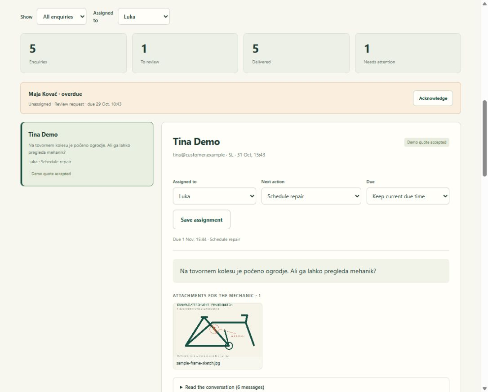

# Šrauf: a connected bike workshop

A customer asks a bike shop a question. The assistant answers from the owner's approved
prices and hours, or hands the conversation to staff. Staff review the request, look at the
photos, write a quote and approve it. **n8n** moves the work between the steps, and every
request and reply is saved, so nothing is lost when a connection fails.

Šrauf, its staff and customers are fictional. It's a portfolio demo that runs locally.

**Watch it:** [90-second walkthrough](https://cesicobrad.github.io/assets/video/srauf.mp4)



## What it does

- **Chat in English, Slovenian or Croatian/Serbian.** Price and opening-hours questions are
  answered from owner-approved facts, with the source shown. Anything custom goes to a person.
- **Handover with context.** The request arrives at the workshop desk with the whole
  conversation and up to three photos (resized, metadata stripped).
- **Quotes.** Staff enter labour and parts, save, check the exact total, then approve. The
  customer can accept or ask a question. A revised or expired quote can't be accepted.
- **Ownership.** Each request has a person, a next action and a due time. Overdue work raises
  an alert.
- **Missing answers become a to-do list.** Questions the assistant couldn't answer are grouped
  in *Improve answers*. The owner writes the approved answer, publishes it and retests.
- **Owner controls.** Change prices or hours and the next answer uses them, no redeploy.
- **Follow-ups.** Three days after a reply with no answer from the customer, n8n drafts a
  follow-up for approval. A customer reply cancels it.

## How it holds up when things go wrong

These are the cases the tests cover, because they're what breaks real automations:

- A repeated form submission creates one enquiry, not two.
- Two staff approving at once send one message.
- If delivery fails, the approved message is kept and retried with the same message ID.
- Conflicting prices are escalated instead of guessed.
- An incoming reply stops pending follow-ups.

## Run it

Needs Node 24+, Python 3.11+ and n8n 2.44.6 installed locally.

```powershell
python -m venv .venv
.venv\Scripts\pip install -r requirements.txt
npm install -g n8n@2.44.6
node scripts/start.mjs
```

Open **http://127.0.0.1:5790/** and press *Start guided demo*. The first start imports three
workflows into a separate n8n database and can take a few minutes. The n8n editor is at
http://127.0.0.1:5798/. If n8n is installed elsewhere, set `N8N_ENTRY` to its `bin/n8n` file.

Optional modes (put keys in `.env`, copied from `.env.example`):

```powershell
node scripts/start.mjs --live-ai                  # Claude answers and drafts (needs ANTHROPIC_API_KEY)
node scripts/start.mjs --live-gmail --gmail-inbox # real email through Gmail, see docs/CONNECTIONS.md
```

## Tests

```powershell
python -B scripts/verify.py   # 77 checks, no keys or network
node scripts/e2e.mjs          # 45 checkpoints through a running n8n
```

## Limits

- By default the assistant makes **no AI calls**: it matches questions against approved facts
  and drafts are labelled templates. Live AI and Gmail are implemented but haven't been tested
  against real accounts.
- Email goes to a local preview inbox. Accepting a quote takes no payment and books nothing.
- There's no staff login. Before real use it would need authentication, backups, a retention
  policy and hosting; the server only listens on this computer.

## Project layout

```text
connected/          saved enquiries, outbox, quotes, photos, approved answers, API
chatbot/            chat engine (from my website-chatbot demo)
web/                customer view, workshop desk, proof tab
n8n/workflows/      the three n8n workflows (intake, delivery, CRM)
scripts/            launcher, tests, end-to-end check
docs/               owner handover, connection guide, screenshots
```

## How I built this

Most of my client work is under NDA, so this is a public stand-in for the kind of system I
build for companies: a chat assistant joined up with the people and tools behind it.

I build with AI coding agents. Codex wrote most of this code and the tests from my brief. My
part is deciding what the tool should do, how staff and customers will use it, what to test
and what to change after testing. The rule I kept from client work: anything that reaches a
customer or involves money gets a person's approval first.

For a real business I'd start from how they handle enquiries today: where they come in, who
answers, what gets lost. Then I build around that, so the new tool replaces the old routine
without a steep learning curve. The question I start every project with is: what do *you* need?

See [the owner handover](docs/HANDOVER.md) for how staff would use it day to day.

## License

MIT. See [LICENSE](LICENSE).
